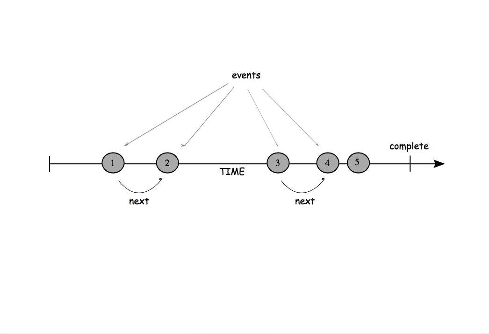
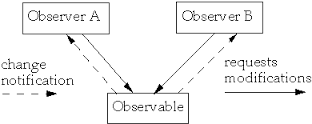

# Using Reactive Extentions (Rx) for JavaScript

## Understanding data streams


[Marble Diagrams](http://rxmarbles.com/)

* sequence of events over time
* any of type of event such as mouse clicks, key presses, bits of network data, etc
* source of the event (producers)
* are listening (consumers)

## Observing state changes

__Pseudocode__

```javascript
var A = 2;
var B = 4;
var C = A + B;
console.log(C); //-> 6
A = 10;  
console.log(C); //->  16
```

## Observer Pattern



## Create Observable [RxJS 4.x](https://github.com/Reactive-Extensions/RxJS) [RxJS 5.x](https://github.com/ReactiveX/rxjs)

> Observables are used to wrap a piece of data (button clicks, key presses, mouse movement, numbers, strings, or arrays) and decorate it with stream-like qualities. Observables allow you to sequence and chain operators together very fluently while abstracting the problem of latency and wait-time away from your code.

* Observables are lazy data types
* Observables represent the producer side
* Created from a variety of different sources

### Observable

```javascript
const streamA = Rx.Observable.of(2);
```

```javascript
const streamA = Rx.Observable.of(2);
const streamB = Rx.Observable.of(4);
const streamC = Rx.Observable.concat(streamA, streamB)
  .reduce((x, y) => x  + y);
streamC.subscribe(console.log); //prints 6
```

| SOURCE                        | OBSERVABLE (STATIC) METHOD
|-------------------------------|---------------------------------------------------------
| of(arg)					    | Converts arguments to an observable sequence
| from(iterable)			    | Converts arguments to an observable sequence
| fromPromise(promise)		    | Converts a Promises/A+ spec-compliant Promise and/or ES2015-compliant Promise to an |observable sequence
| fromEvent(element, eventName) | Creates an observable sequence by adding an event listener to the matching DOMElement, jQuery element, Zepto Element, Angular element, Ember.js element, or EventEmitter

### Observer

* Observers represent the consumer side 
* Observer is a very simple API based on the Iterator pattern
* Functions (next, error, complete) are called on every event that’s pushed onto an observable
* Behind the scenes, the shorthand subscription above streamC.subscribe(console.log) creates an Observer object

```javascript
const observer = Rx.Observer.create(
    function next(val) {  
        console.log(val);
    },
    function error(err) { 
        ; // fired in case an exception occurs
    },
    function complete() {
        ; // fired when all events have been processed
    }
);
``` 