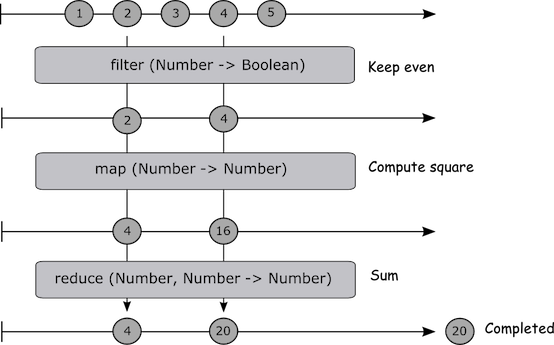

# Sequencing with data streams

## Functional Programming and uniformity to Arrays

> Arrays are predictable streams because they are all in memory at the time of consumption.

| NAME                          | DESCRIPTION
|-------------------------------|---------------------------------------------------------
| map(fn)					    | Projects each element of an observable sequence into a new form
| filter(predicate)			    | Filters the elements of an observable sequence based on a predicate
| reduce(accumulator, [seed])	| Applies an accumulator function over an observable sequence, returning the result of the aggregation as a single element in the result sequence. The specified seed value is used as the initial accumulator value



```javascript
const arr = [1, 2, 3, 4, 5];
const result = arr
	.filter(x => (x % 2) === 0)
	.map(x => x * x)
	.reduce((a, b) => a + b, 0);
console.log(result); //-> 20
```

> Writing functional code eliminates the complexity involved in looping and conditional statements in favor of higher-order functions.

## Dealing with time

| NAME                          	| DESCRIPTION
|-----------------------------------|---------------------------------------------------------
| Rx.Observable.interval(period)    | Projects each element of an observable sequence into a new form
| Rx.Observable.timer(dueTime)		    	| Filters the elements of an observable sequence based on a predicate


## Handling user input

> Observables to interact with DOM events.

### Vanilla

```javascript
const mouseClicks = Rx.Observable.fromEvent(document, 'click');
const subscription = mouseClicks
	.do(x => console.log(x))
	.subscribe();

subscription
	.unsubscribe();
```
### jQuery

```javascript
const input = $('#input');
const mouseClicks = Rx.Observable.fromEvent(input, 'click');

const subscription = mouseClicks
	.do(x => console.log(x))
	.subscribe();

subscription
	.unsubscribe();
```

## Handle Node.JS EventEmitter events

```javascript
const EventEmitter = require('events').EventEmitter;
const Rx = require('rx');
const eventEmitter = new EventEmitter();

const source = Rx.Observable.fromEvent(eventEmitter, 'data', (foo, bar) => ({ foo: foo, bar: bar }));

const subscription = source.subscribe(
  x => console.log('Next: foo -' + x.foo + ', bar -' + x.bar),
  error => console.log('Error: ' + error),
  () => console.log('Completed')
);

eventEmitter.emit('data', 'baz', 'quux');
```

## Handling asynchronous calls

